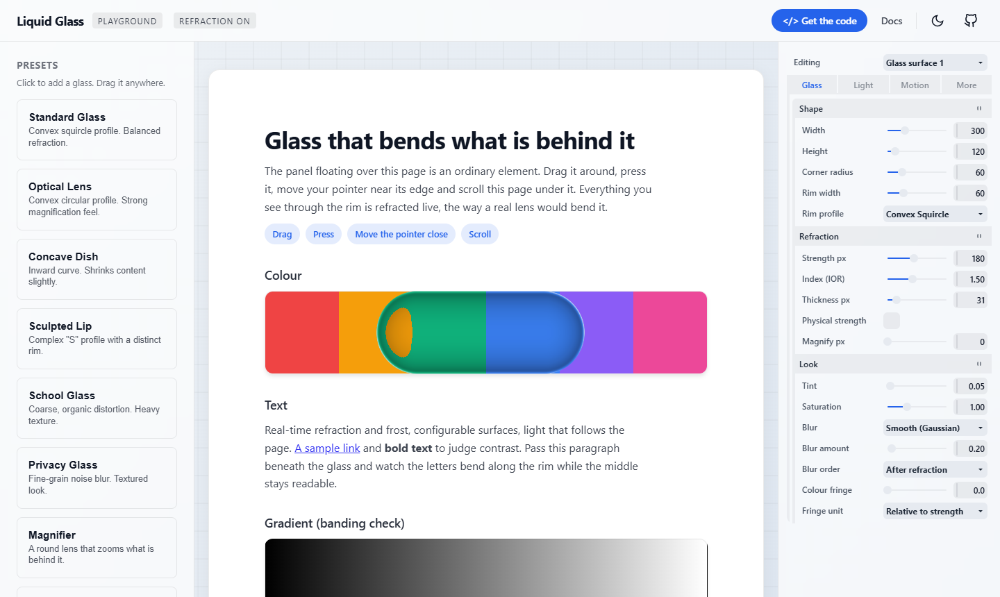
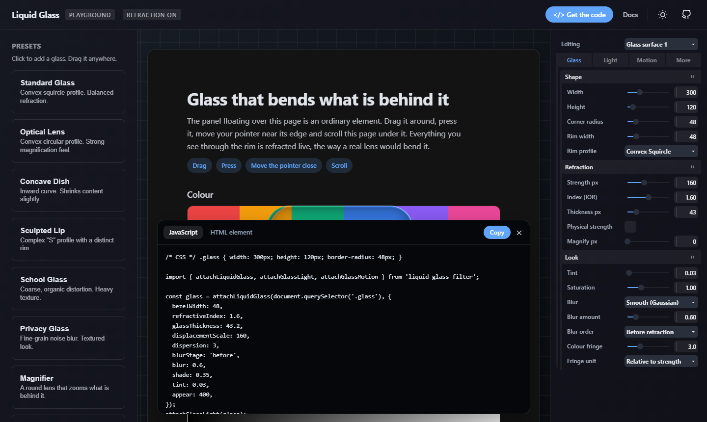

# Liquid Glass

Real glass refraction for any element on a web page. Whatever sits behind the element bends
through its rim the way it would through a lens, while the content inside stays sharp.

[](https://j-houghton.github.io/LiquidGLass-UI/)

**[Try the live playground](https://j-houghton.github.io/LiquidGLass-UI/)** · [Full guide](docs/usage.md)

- One function call on an element you already have. No framework, no dependencies.
- Looks physical because it is: the bend comes from a lens shape and an index of refraction.
- Light on the rim follows the page and your pointer. Presses and drags feel springy.
- Works everywhere: Chrome and Edge get the real lens, Safari and Firefox get a clean frosted fallback.

## Install

Not on npm yet. Install it straight from GitHub:

```bash
npm install github:J-Houghton/LiquidGLass-UI
```

## Use it

```html
<div class="card" style="width: 320px; height: 160px; border-radius: 24px">Hello</div>
```

```js
import { attachLiquidGlass } from 'liquid-glass-filter';

const glass = attachLiquidGlass(document.querySelector('.card'));
```

That is the whole setup. The glass follows the element's size and corner radius by itself.

Change the look at any time, or remove it:

```js
glass.update({ tint: 0.1, dispersion: 2 }); // darker, with a colour fringe
glass.destroy();
```

## Make it feel alive

```js
import { attachLiquidGlass, attachGlassLight, attachGlassMotion } from 'liquid-glass-filter';

const glass = attachLiquidGlass(card, { shade: 0.35, appear: 400 });
attachGlassLight(glass);   // the rim highlight follows the page and the pointer
attachGlassMotion(glass);  // springy press, squash while dragging
```

## Prefer plain HTML?

```html
<script type="module">
  import { defineLiquidGlassElements } from 'liquid-glass-filter/elements';
  defineLiquidGlassElements();
</script>

<liquid-glass-container radius="24" shade="0.35" light motion style="width: 320px; height: 160px">
  Hello
</liquid-glass-container>
```

## Find your look in the playground

The [playground](https://j-houghton.github.io/LiquidGLass-UI/) has ready-made presets (standard
glass, lens, magnifier, prism, privacy glass and more) and a slider for every setting. When it
looks right, press **Get the code** and paste the result into your project.



The settings you will reach for most:

| Setting | What it does |
|---|---|
| `bezelWidth` | How wide the bending rim is |
| `displacementScale` | How strongly it bends |
| `tint`, `saturation`, `blur` | Darker, more vivid, softer |
| `shade` | Darkens the edge so the glass looks thick |
| `dispersion` | Rainbow fringe along the rim |
| `magnify` | Zooms what is behind, like a magnifying glass |

## Browser support

| Browser | What you get |
|---|---|
| Chrome, Edge, Opera, Brave | The real refracting lens |
| Safari, Firefox | A frosted-glass fallback, applied automatically |

Safari and Firefox can get real refraction too, with one extra option. See
[the guide](docs/usage.md#7-browser-support-fallback-and-the-content-side-lens).

## Learn more

[`docs/usage.md`](docs/usage.md) is the complete reference: every option and parameter, React,
Vue and Svelte snippets, the light and motion APIs, performance notes, troubleshooting, and how
to work on the library itself.

## License

MIT
